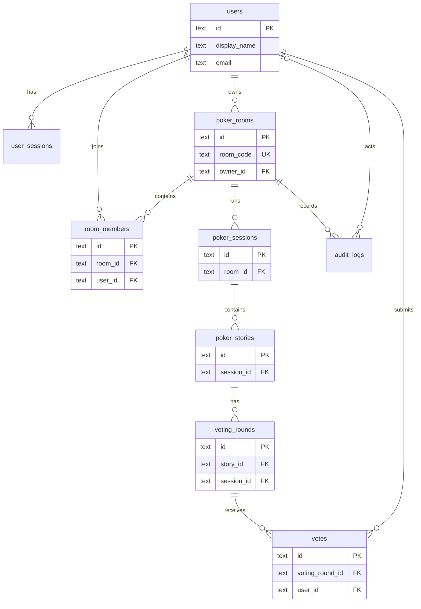

# Planning Poker Backend

Cloudflare Workers backend for a Planning Poker application.

## Architecture

- `apps/api`: independently deployable Hono REST API Worker.
- `apps/realtime`: independently deployable WebSocket Worker with a room Durable Object.
- `packages/contracts`: shared Zod schemas and real-time protocol types.
- `packages/database`: Drizzle/D1 database utilities and future schema definitions.

The API and realtime services use separate Wrangler deployments and bindings. The realtime room path is
`/rooms/:roomId/ws`. Durable Object voting behavior is intentionally deferred to a later phase.

## Prerequisites

- Node.js 22 or newer
- pnpm 10 or newer
- A Cloudflare account for remote deployment

## Version choices

The foundation uses TypeScript 5.9, Hono 4.10, Drizzle ORM 0.44, Zod 4.1, Wrangler 4.54, and Vitest 3.2.
These versions provide a stable pnpm workspace and Workers-compatible baseline.

## Local setup

```bash
pnpm install
cp .env.example .env
```

Cloudflare bindings are authoritative in `apps/api/wrangler.jsonc` and
`apps/realtime/wrangler.jsonc`. Placeholder D1 and account/resource values must be replaced through your
own Cloudflare configuration; this repository does not contain account IDs or database IDs.

## Running locally

API:

```bash
pnpm dev:api
```

Realtime:

```bash
pnpm dev:realtime
```

Health checks:

- API: `GET http://localhost:8787/health`
- API readiness: `GET http://localhost:8787/health/ready`
- Realtime: `GET http://localhost:8787/health` (when run on its configured Wrangler port)

## Available scripts

| Script              | Purpose                           |
| ------------------- | --------------------------------- |
| `pnpm dev:api`      | Run the REST API Worker locally   |
| `pnpm dev:realtime` | Run the realtime Worker locally   |
| `pnpm build`        | Type-check all workspace packages |
| `pnpm typecheck`    | Type-check all workspace packages |
| `pnpm lint`         | Run ESLint                        |
| `pnpm format:check` | Check Prettier formatting         |
| `pnpm test`         | Run workspace tests               |

## Database

The database package owns the Drizzle schema, migrations, and development seed data.

### Schema and relationships



Timestamps are UTC epoch milliseconds stored in integer columns. Soft deletion is used for users, rooms,
and stories. Refresh-token reuse is prevented by a unique hash index; room membership and participant
votes use composite unique indexes. Voting rounds reference both the story and its session, keeping the
round's session relationship consistent.

SQLite foreign key constraint names cannot be declared in migration SQL; generated foreign keys use
descriptive names in the Drizzle schema and descriptive migration relationships.

### Migration commands

Generate a migration after changing `packages/database/src/schema.ts`:

```bash
pnpm db:generate
```

Apply migrations to the local API D1 database:

```bash
pnpm db:migrate:local
```

Load development seed data:

```bash
pnpm db:seed
```

Wrangler migration SQL is stored under `packages/database/migrations`; both Worker applications expose
an app-local `migrations` symlink to that single source. D1 does not support an automatic migration rollback.
Recovery is performed by restoring a database backup or adding a reviewed forward recovery migration.

## Shared API contracts

`packages/contracts` is the runtime and TypeScript contract source for REST DTOs, errors, pagination,
authentication, room state, voting privacy, and versioned WebSocket messages. Zod schemas and inferred
types are exported to both Workers; duplicate protocol definitions must not be added in application code.

REST success responses use `{ "data": ... }`. Paginated responses use `{ "data": [...], "pagination": {
"page", "pageSize", "totalItems", "totalPages" } }`. REST errors use:

```json
{
  "error": {
    "code": "VALIDATION_ERROR",
    "message": "Invalid input",
    "correlationId": "request-id",
    "details": []
  }
}
```

Supported error codes are `VALIDATION_ERROR`, `UNAUTHORIZED`, `FORBIDDEN`, `NOT_FOUND`, `CONFLICT`,
and `INTERNAL_ERROR`. Pagination queries support `page`, `pageSize`, `search`, `sortBy`, and
`sortDirection`.

WebSocket messages use a versioned envelope:

```ts
{
  version: "1",
  type: "SELECT_VOTE",
  messageId: "uuid",
  timestamp: "ISO-8601 timestamp",
  payload: {}
}
```

Before reveal, public snapshots and events contain only participant identity and `hasVoted`; they never
contain hidden numeric or special values. Revealed vote values are available only through revealed-state
and voting-results schemas.

OpenAPI 3.1 JSON is available from `GET /openapi.json` on the API Worker. It reuses Zod-generated JSON
schemas from `packages/contracts`.
